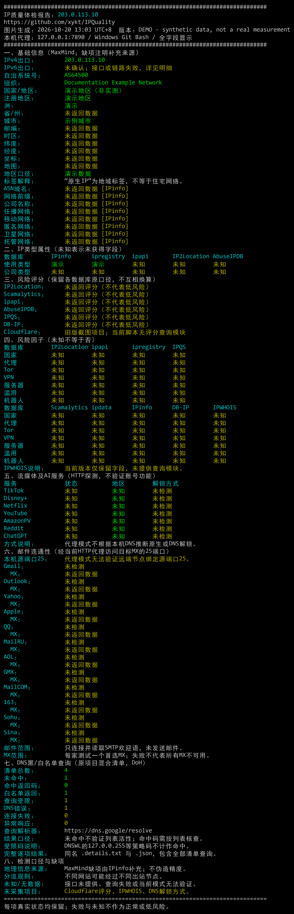

# IPQuality Windows Report

Windows 上检测当前代理出口 IP，自动生成黑底彩色完整 PNG 报告，同时保存 JSON、TXT、ANSI 和逐项查询明细。

基于 [xykt/IPQuality](https://github.com/xykt/IPQuality)，增加 Windows 便携运行与完整字段报告。第三方适配项目，非上游官方发行版。

## 普通用户：下载、解压、双击

1. 在本仓库 **Releases** 下载 `IPQuality-Windows-x64-Portable-v1.0.0.zip`。**Code → Download ZIP 只是源码，不包含运行环境。**
2. 完整解压到一个可写文件夹，推荐路径不要过长；不要在压缩包内直接打开。
3. 打开自己的代理软件，双击 `Start.cmd`。
4. 输入代理软件的 HTTP / mixed 端口，例如 `7890` 或 `http://127.0.0.1:7890`。程序会检查常见本地端口，回车可采用建议值。
5. 等待显示 **检测完成**。图片会自动打开，所有结果在 `reports` 文件夹。

适用 Windows 10/11 x64。便携发行包内含 Python、Pillow、Bash、curl、jq、bc，不需要另装 Python、Git、Docker，也不需要管理员权限。检测仍需网络和可用代理。

如果双击后失败，运行 `Self-Test.cmd` 检查运行环境。首次运行可能出现 Windows 对未签名脚本或下载文件的提示；本项目没有代码签名证书。

## 输出与完成状态

每次运行使用独立时间戳，不覆盖旧结果。

| 文件 | 内容 |
| --- | --- |
| `.png` | 全字段彩色图片报告，缺失项明确显示未知 |
| `.json` | 上游数据及 Supplemental 补充字段 |
| `.txt` / `.ansi` | 完整文本与终端颜色版本 |
| `.raw.ansi` | 上游原始终端输出 |
| `.details.txt` | 全部 DNS 查询、SMTP 结果、错误原因 |
| `.status.json` | `running` / `completed` / `failed`，用于判断本次是否完成 |

通常需要数分钟，默认总超时 15 分钟。窗口暂停不等于成功，应看到“检测完成”以及本次 `.status.json` 的 `completed`。

## 检测范围与结果口径

- IPv4 基本信息、网络类型、多数据库风险评分/因子、上游支持的流媒体及 AI HTTP 探测。
- MaxMind 缺失的城市、时区等字段尝试从 IPinfo 补全，并注明来源。
- IPv6 通过专用接口验证，接口或链路失败记为“未确认”。
- 12 家邮箱供应商：通过当前 HTTP CONNECT 代理连接首选 MX 的目标 25 端口，仅读取欢迎语并 QUIT，不发送邮件；这不测试远端节点的源端口25。
- 上游 DNS 名单通过 Google DoH 查询，逐项保留结果；名单可能混有黑名单、白名单及失效项目。DNSWL 的配额拒绝不算黑名单命中；无记录不证明该名单仍有效。
- 未实现的 Cloudflare 评分、IPWHOIS、DNS 解锁类型等明确列为未采集，失败不能当作低风险。

代理规则模式下，不同服务可能经过不同出口，报告不能保证所有探测使用同一 IP。评分也不能预测账号封禁、模型表现或永久解锁。“原生 IP”是上游地域口径，不等于住宅网络。

检测会向上游脚本中的数据库、服务站点、IPinfo、ipify、Google DoH 和邮箱 MX 发起网络请求；DNS 查询包含待检测 IPv4 的反向地址。原脚本在线分享报告功能默认关闭，结果保存在本机。报告含完整出口 IP 和近似位置，公开分享前请自行脱敏。

## 命令行

```bat
Start.cmd --proxy http://127.0.0.1:7890
Start.cmd --proxy 7897 --no-open
Start.cmd --self-test
```

也可通过当前进程的 `IPQ_PROXY` 环境变量指定地址。不修改系统代理、代理软件配置或系统证书库。
便携启动器暂只支持不带账号密码的 HTTP / HTTPS 代理，SOCKS 专用端口不能直接用于补充检测。

## 示例



示例使用文档保留地址 `203.0.113.10` 和合成数据，仅展示排版。

## 开发与构建

构建者需要 Python 3.14+、Pillow，以及 Windows x64 Git for Windows。运行者不需要安装这些软件。

```powershell
python build_portable.py --git-root "C:\Program Files\Git"
```

构建器从官方来源下载锁定版本并校验 SHA256，将 Git 的 Bash/工具运行时和许可证打包，生成 `dist/` 下的便携 ZIP 与校验文件。构建依赖元数据在 `assets.lock.json`，实际来源与版本写入包内 `THIRD_PARTY.md`。

## 许可证

[GNU AGPL v3](LICENSE)。来源与修改说明见 [NOTICE.md](NOTICE.md)。第三方运行环境遵循各自许可证。
